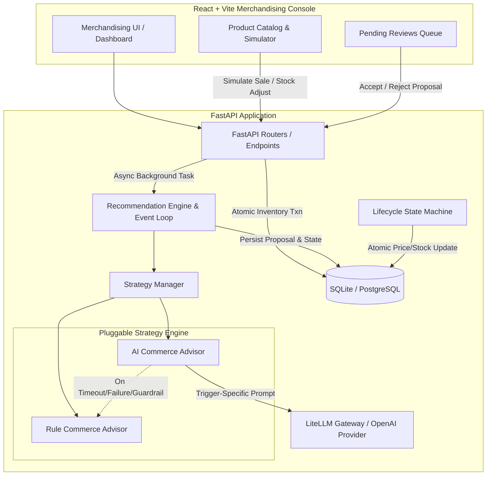

# StockPulse - Agentic Inventory Management & Dynamic Pricing Console

[](https://fastapi.tiangolo.com)
[](https://react.dev)
[](https://www.python.org)
[](https://vitejs.dev)

**StockPulse** is an AI-assisted, human-in-the-loop inventory management and dynamic pricing merchandising platform. It autonomously observes real-time inventory and sales velocity events, reasons about pricing and replenishment trade-offs using specialized LLM intelligence, proposes actionable merchandising recommendations, and enforces an explicit human review checkpoint before mutating operational catalog state.

---

## Architecture Overview



---

## Core Capabilities

1. **Agentic Commerce Loop (OBSERVE -> REASON -> PROPOSE -> HUMAN CHECKPOINT -> ACT)**:
   - **Observe**: Listens to inventory decrement and order sales transactions.
   - **Reason**: Evaluates business conditions against dynamic category benchmarks.
   - **Propose**: Generates strongly typed, structured pricing and reorder suggestions.
   - **Human Checkpoint**: Merchandisers review confidence, reasoning, and economic impact.
   - **Act**: One-click acceptance atomically updates product pricing or triggers simulated replenishment.

2. **Trigger-Specific AI Prompt Engineering**:
   - **`INVENTORY_LOW`**: Focuses on scarcity pricing, margin preservation, stock rationing, and urgent lead-time replenishment.
   - **`DEMAND_SPIKE`**: Analyzes surge velocity multiples, monetizes customer demand without price gouging, and prevents rapid stockouts.
   - **Automated Context Injection**: Category average velocities are computed by the backend and passed into the LLM context.

3. **Runtime Strategy Switching Without Restarts**:
   - Switch active merchandising intelligence between **`AI`** and **`RULE`** modes on the fly via the API (`POST /strategy`) or the UI toggle bar.

4. **100% Availability with Graceful Rule Fallbacks & Guardrails**:
   - Resilient against LLM gateway timeouts, connection drops, schema violations, or absurd hallucinations (e.g. price multipliers outside `[0.3x, 3.0x]`).
   - Automatically executes deterministic rule fallback and marks suggestions with audit notes.

5. **Asynchronous Non-Blocking Event Decoupling**:
   - Orders (`POST /products/{id}/orders`) and stock updates (`PATCH /products/{id}/stock`) execute with sub-50ms latency.
   - LLM generation runs in background tasks, decoupled from transactional HTTP responses.

6. **Idempotency & Deduplication Guards**:
   - Prevents duplicate pending suggestions for the same product, trigger reason, and suggestion type during rapid sales bursts.

---

## State Machine Transitions

| Current State | Condition / Event | Next State | System Action |
|---|---|---|---|
| `ACTIVE` | Stock drops below threshold (`0 < stock < threshold`) | `PRICE_REVIEW_PENDING` | Dispatches async `INVENTORY_LOW` recommendation tasks |
| `ACTIVE` | Stock drops to 0 | `OUT_OF_STOCK` | Disables sales simulation; generates urgent reorder recommendation |
| `PRICE_REVIEW_PENDING` | Merchandiser accepts/rejects all pending suggestions | `ACTIVE` | Re-evaluates stock level; clears review flags |
| `PRICE_REVIEW_PENDING` | Merchandiser accepts pricing suggestion | `PRICE_REVIEW_PENDING` / `ACTIVE` | Atomically mutates `Product.current_price` |
| `PRICE_REVIEW_PENDING` | Merchandiser accepts reorder suggestion | `ACTIVE` | Atomically adds `recommended_quantity` to `Product.stock_level` (simulated inbound shipment) |

---

## Seed Data Catalog

| ID | SKU | Product Name | Category | Initial Price | Stock | Threshold | 24h Velocity | Initial Status | Demo Role |
|---|---|---|---|---|---|---|---|---|---|
| `PRD-001` | `SKU-ELEC-001` | Wireless Earbuds Pro | `ELECTRONICS` | $79.99 | 45 | 20 | 3 | `ACTIVE` | Steady baseline |
| `PRD-002` | `SKU-ELEC-002` | USB-C Hub 7-Port | `ELECTRONICS` | $34.99 | 120 | 30 | 1 | `ACTIVE` | High inventory |
| `PRD-003` | `SKU-APP-001` | Organic Cotton T-Shirt | `APPAREL` | $24.99 | 8 | 15 | 12 | `PRICE_REVIEW_PENDING` | **Primary Inventory-Low Demo** |
| `PRD-004` | `SKU-APP-002` | Running Shorts - Navy | `APPAREL` | $39.99 | 55 | 20 | 2 | `ACTIVE` | Baseline |
| `PRD-005` | `SKU-HOME-001` | Ceramic Pour-Over Set | `HOME` | $49.99 | 22 | 10 | 4 | `ACTIVE` | Baseline |
| `PRD-006` | `SKU-HOME-002` | LED Desk Lamp - Dimmable | `HOME` | $59.99 | 0 | 15 | 0 | `OUT_OF_STOCK` | Stockout recovery |
| `PRD-007` | `SKU-ELEC-003` | Portable Charger 20K | `ELECTRONICS` | $44.99 | 18 | 25 | 8 | `ACTIVE` | Moderate velocity |
| `PRD-008` | `SKU-APP-003` | Hoodie - Heather Grey | `APPAREL` | $54.99 | 11 | 12 | 15 | `ACTIVE` | **Primary Demand-Spike Demo** |

---

## Quickstart & Run Commands

### 1. Backend Setup

```powershell
# Navigate to backend
cd backend

# Option A: With uv (recommended)
uv sync
uv run python run.py

# Option B: With standard Python venv
.\.venv\Scripts\python run.py
```

* **Backend URL**: `http://localhost:8000`
* **Swagger OpenAPI Docs**: `http://localhost:8000/docs`
* **Health Check**: `http://localhost:8000/health`

### 2. Frontend Setup

```powershell
# Navigate to frontend
cd frontend

# Install dependencies and start Vite dev server
npm install
npm run dev
```

* **Merchandising UI**: `http://localhost:5173`

---

## Environment Variables & Configuration

Create `backend/.env` (based on `backend/.env.example`):

```env
# Application Settings
PROJECT_NAME=StockPulse
DEBUG=True
ACTIVE_STRATEGY=ai

# Database
DATABASE_URL=sqlite:///./stockpulse.db

# LLM Gateway Configuration
LLM_BASE_URL=https://litellm-qc.zycus.net/v1
LLM_MODEL=qwen-cursor
LLM_API_KEY=your_llm_api_key_here
LLM_PRODUCT=PC1
LLM_TIMEOUT_SECONDS=10.0

# Commerce & Guardrail Parameters
PRICE_MIN_MULTIPLIER=0.3
PRICE_MAX_MULTIPLIER=3.0
DEMAND_SPIKE_VELOCITY_MULTIPLE=3.0

# CORS
CORS_ORIGINS=http://localhost:5173,http://127.0.0.1:5173
```

> **Security Notice**: Never commit `.env` files or API credentials to version control. The repository ignores `.env` files by default.

---

## 5-Minute Demo Walkthrough

1. **Open Dashboard**: Open `http://localhost:5173` in your browser. Notice the executive summary KPI cards and active strategy toggle (`AI Strategy` vs `Rule Strategy`).
2. **Observe Seeded Review**: Notice product `PRD-003 (Organic Cotton T-Shirt)` is in `PRICE_REVIEW_PENDING` with pending pricing and reorder suggestions in the **Pending Reviews Queue**.
3. **Simulate Inventory-Low Event**:
   - In the Product Table, locate `PRD-007 (Portable Charger 20K)` (Stock: 18, Threshold: 25).
   - Enter quantity `5` in the simulate sale box and click `⚡ Sell`.
   - Stock decrements immediately to 13.
   - Within 2-3 seconds, the background agentic loop generates and displays new `INVENTORY_LOW` pricing and reorder suggestions.
4. **Inspect Reasoning & Confidence**:
   - Review the AI reasoning note, trigger tag (`INVENTORY_LOW`), and confidence score.
5. **Human Checkpoint (Accept Pricing)**:
   - Click **Accept Price** on the pricing card.
   - Notice the catalog price for `PRD-007` updates instantly.
6. **Human Checkpoint (Accept Reorder)**:
   - Click **Accept Order** on the reorder card.
   - Notice the product stock increases atomically by the suggested batch size (simulating inbound inventory arrival).
7. **Simulate Demand Spike**:
   - Select `PRD-008 (Hoodie - Heather Grey)` which has high velocity (15).
   - Click `⚡ Sell` to trigger order events.
   - The engine detects `DEMAND_SPIKE` (>3x category average) and generates surge-capture suggestions.
8. **Runtime Strategy Switching**:
   - In the navbar, toggle the strategy switch to `Rule Strategy`.
   - Trigger a manual price recommendation on `PRD-001` (`🏷️ Price`).
   - Notice deterministic rule calculations are returned instantly.

---

## Running Automated Tests

Run the complete 24-test suite validating API contracts, state machine transitions, async tasks, and AI fallback guardrails:

```powershell
cd backend
.\.venv\Scripts\python -m pytest
```

Output:
```text
============================= test session starts =============================
collected 24 items

tests\test_api.py ........................                               [100%]
======================== 24 passed in 0.44s ========================
```

---

## Architecture Decision Records (ADRs)

Comprehensive architecture records are documented in [`ADR.md`](file:///c:/Users/zycus/myProject/ADR.md):
- **ADR 1**: Commerce Strategy Layer & Domain Placement
- **ADR 2**: Specialized Trigger Prompts with Unified Output Contracts
- **ADR 3**: Runtime Strategy Switching Without Restarts
- **ADR 4**: Graceful LLM Failure Fallbacks & Guardrails
- **ADR 5**: Asynchronous Agentic Loop & Event Decoupling
- **ADR 6**: Idempotency & Recommendation Deduplication Guard
- **ADR 7**: Human Checkpoint & State Machine Transitions
- **ADR 8**: Technology Stack Selection (FastAPI + React + SQLite/PostgreSQL)
- **ADR 9**: Future Extension Seams (Sprint 2 Roadmap)

---

## Future Extension Seams (Sprint 2 Roadmap)

The codebase includes extensible domain fields and pluggable strategy contracts designed for Sprint 2 enhancements:
1. **Competitor Pricing Sync**: `cost_price` and `supplier_id` are already present in `Product`. A new `CompetitorAwareStrategy` can implement `PricingStrategy` and register directly in `StrategyManager`.
2. **Margin Floor Safeguards**: Enforce `recommended_price >= cost_price * (1 + margin_floor)`.
3. **Outbound Purchase Orders**: Accepting a `ReorderSuggestion` can emit automated purchase order payloads to external supplier EDI endpoints.
4. **Price Cooldown Guards**: Enforce maximum change velocity per SKU (e.g., at most 1 price modification per 7 days).
